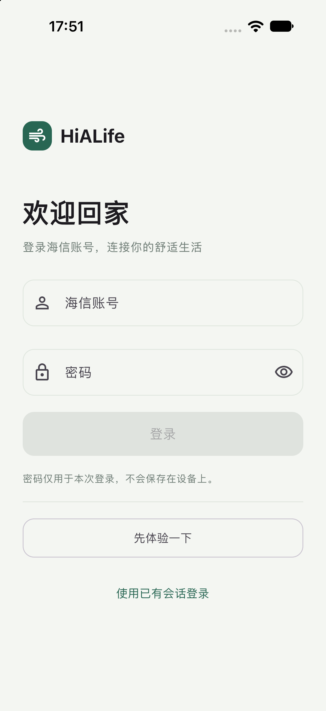
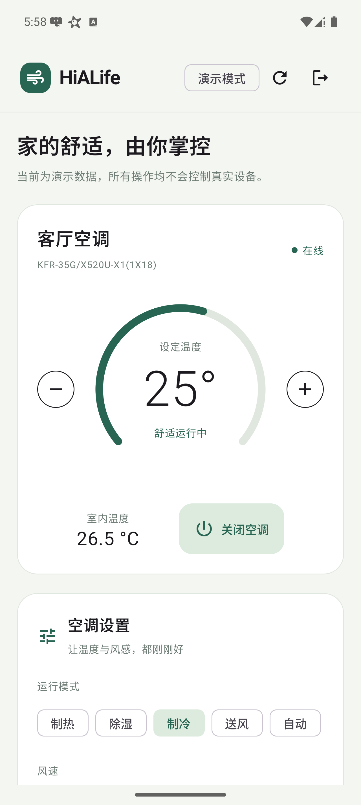

# 验证记录

日期：2026-11-11。

## 构建与接口

| 项目 | 结果 |
| --- | --- |
| Android Debug APK | `:composeApp:assembleDebug` 成功 |
| Desktop JVM | 编译、启动、macOS `.app` 打包成功 |
| iOS ARM64 Simulator | Xcode 完整构建成功，在 iPhone 18 Pro / iOS 27 模拟器启动并显示登录页 |
| 共享协议测试 | `:composeApp:desktopTest`，7 项通过，0 失败 |
| 真实接口只读查询 | 使用新 Kotlin `HiLifeApi` 和本机已有会话，成功获取 1 台在线空调、37 项可执行能力 |

协议测试使用独立 Python / OpenSSL 向量验证 UTF-8 MD5/Base64 签名和 AES-256-CBC 加密，并覆盖登录请求签名字节一致性、不保存密码、模式字段映射、刷新令牌先保存后查询，以及认证只重试一次，以及控制响应丢失时不自动重发。

桌面端通过实际窗口操作验证了登录页、进入演示模式及温度从 25° 调整到 26°。

## 未验证范围

- 真实账号密码登录：尚未输入用户密码验证；可使用已有会话导入。
- 真实设备控制执行效果：本轮没有向真实空调发送开关、温度、模式、风速或新风控制指令。
- iOS 真机签名和部署：需要用户自己的 Apple 开发团队配置。
- Windows / Linux 桌面包：工程已配置 MSI / DEB，未在相应操作系统构建或运行。

## Android 设备探索与复验

使用 ARTEMIS 在用户选择的 Pixel_9_Pro_2（Android 16）上执行：

- 登录页输入框、密码显隐入口、空表单登录禁用、已有会话弹窗和取消。
- 进入演示，显示在线空调、25° 设定温度和 26.5°C 室温。
- 温度 25° → 26° → 25°、运行模式、自动风、新风开启、内循环、新风低/中/高风选择态。
- 最新 APK 补充验证整机关闭和重新开启、退出确认返回登录页、再次进入演示。
- 首轮复核发现页面滚到底部后刷新提示不可见；将提示移到顶部固定区域后，复验确认“演示状态已更新”在底部场景持续可见。

首轮 Pro 探索发现提示问题后终止部署修复；最新 Flash 回归完成，检查了操作轨迹及执行日志。最终停留演示控制面板。

演示交互验证不能替代真实设备状态回读。
